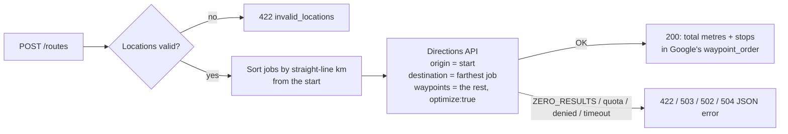

# Route Manager

A small Rails API that plans a delivery driver's run. Give it the driver's
starting point and a list of job locations; it decides the visiting order and
asks the Google Maps Directions API how far the driving route is.

It started as a take-home exercise for a courier platform (the driver is a
"gogetter" in the code) and has since been moved to Ruby 3.4 and Rails 8.1,
given input validation and proper handling of Google's failure modes.

## How a route is planned



- Stops are first sorted by great-circle distance from the start
  (`distance_km`). The farthest stop becomes the route's destination.
- The remaining stops go to Google as waypoints with `optimize:true`, so Google
  may reorder them. The response lists the stops in the order Google drove,
  which is the order `total_driving_distance` describes.
- `total_driving_distance` is the sum of Google's leg distances, in metres.
- Every location is validated before any request leaves the app, so a bad
  address or coordinate never costs a billable API call.

## Endpoints

| Method | Path | What it does |
| --- | --- | --- |
| `POST` | `/routes` | Plans a route for the locations in the JSON body. |
| `GET` | `/jobs` | Plans the built-in sample: one driver and three jobs around Petaling Jaya and Kuala Lumpur. |
| `GET` | `/up` | Health check (200 when the app boots). |

### Request body for `POST /routes`

```json
{
  "origin": { "lat": 3.1390, "long": 101.6869, "address": "Merdeka 118, Kuala Lumpur" },
  "jobs": [
    { "id": "J-104", "lat": 3.1579, "long": 101.7116, "address": "Suria KLCC, Kuala Lumpur" },
    { "id": "J-105", "lat": 3.1291, "long": 101.6710, "address": "Bangsar Village, Kuala Lumpur" },
    { "id": "J-106", "lat": 3.0738, "long": 101.6078, "address": "Sunway Pyramid, Petaling Jaya" }
  ]
}
```

- `lat` must be between -90 and 90 and `long` between -180 and 180. Numbers
  or numeric strings are accepted.
- `address` is required: a non-blank string of up to 500 characters. It is
  passed through for the driver; routing uses the coordinates.
- `id` is optional and is echoed back so the client can match stops to jobs.
- `jobs` must hold 1 to 26 locations, which is the Directions API's limit of 25
  waypoints plus the destination.

## Examples

These were captured from the Docker image below, with `GOOGLE_DIRECTIONS_URL`
pointing at a local stub instead of Google. For the `/jobs` sample, the stub
replays the real Directions response recorded in the spec cassettes. For the
other requests it returns synthetic legs (straight-line distance x 1.3) and
keeps the waypoints in the order they were sent, so the metre values are
illustrative.

**A planned route** (`POST /routes` with the body above), `200 OK`:

```json
{
  "total_driving_distance": 29187,
  "job_routes": [
    { "id": "J-105", "lat": 3.1291, "long": 101.671, "address": "Bangsar Village, Kuala Lumpur", "distance_km": 2.08 },
    { "id": "J-104", "lat": 3.1579, "long": 101.7116, "address": "Suria KLCC, Kuala Lumpur", "distance_km": 3.46 },
    { "id": "J-106", "lat": 3.0738, "long": 101.6078, "address": "Sunway Pyramid, Petaling Jaya", "distance_km": 11.39 }
  ]
}
```

**The built-in sample** (`GET /jobs`, replaying a recorded Google response), `200 OK`:

```json
{
  "total_driving_distance": 33800,
  "job_routes": [
    { "id": 2, "lat": 3.1115114, "long": 101.5861952, "address": "1673, Jalan PJU 1a/4a, 47310 Petaling Jaya, Selangor, Malaysia", "distance_km": 1.24 },
    { "id": 1, "lat": 3.0716104, "long": 101.6055764, "address": "1, Jalan PJS 11/15, Bandar Sunway, 46150 Petaling Jaya, Selangor, Malaysia", "distance_km": 5.96 },
    { "id": 3, "lat": 3.1660785, "long": 101.6531737, "address": "L1-02, 1 Mont Kiara Mall, Jalan Kiara, Mont Kiara, 50480 Kuala Lumpur, Malaysia", "distance_km": 8.67 }
  ]
}
```

**A missing address and a bad coordinate.** The origin has no `address`, and
job 1 has `"lat": "north"` and `"address": " "`. Response: `422 Unprocessable Content`.

```json
{
  "error": "invalid_locations",
  "details": {
    "origin": ["Address can't be blank"],
    "jobs[1]": ["Lat is not a number", "Address can't be blank"]
  }
}
```

**No road to the destination.** The only job is on Pulau Tioman, and the stub
answers `ZERO_RESULTS` as Google does. Response: `422 Unprocessable Content`.

```json
{ "error": "route_not_found", "message": "Google found no driving route between these locations." }
```

**Directions service unreachable** (stub stopped), `502 Bad Gateway`:

```json
{ "error": "directions_unavailable", "message": "The Google Directions API did not give a usable answer." }
```

**A body that is not JSON**, `400 Bad Request`:

```json
{ "error": "invalid_json", "message": "The request body is not valid JSON." }
```

### Error codes

| HTTP | `error` | Cause |
| --- | --- | --- |
| 400 | `invalid_json` | Request body could not be parsed. |
| 422 | `invalid_locations` | Validation failed; `details` is keyed by `origin` or `jobs[i]`. |
| 422 | `route_not_found` | Google returned `ZERO_RESULTS`, `NOT_FOUND` or `MAX_ROUTE_LENGTH_EXCEEDED`. |
| 502 | `request_denied` | `REQUEST_DENIED` or `INVALID_REQUEST`: usually a missing, restricted or unbilled key. |
| 502 | `directions_unavailable` | `UNKNOWN_ERROR`, an HTTP error, an unreadable body, or a network failure. |
| 503 | `quota_exceeded` | `OVER_QUERY_LIMIT` or `OVER_DAILY_LIMIT`. |
| 504 | `directions_timeout` | No answer within `GOOGLE_MAPS_TIMEOUT_SECONDS`. |

## Running it

You need a Google Maps Platform key with the Directions API enabled. The specs
do not need one.

### With Docker

```sh
docker build -t route-manager .
docker run --rm -p 3000:3000 \
  -e SECRET_KEY_BASE="$(openssl rand -hex 64)" \
  -e GOOGLE_API_KEY=your-key \
  -e RAILS_FORCE_SSL=false \
  route-manager
curl -s http://localhost:3000/jobs
```

The image runs as an unprivileged `rails` user (uid 1000). Leave out
`RAILS_FORCE_SSL=false` when the container sits behind a TLS-terminating proxy.

### Locally

With Ruby 3.4.12 (see `.ruby-version`):

```sh
bundle install
cp .env.example .env        # then fill in GOOGLE_API_KEY
export $(grep -v '^#' .env | xargs)
bin/rails server
```

### Configuration

| Variable | Default | Purpose |
| --- | --- | --- |
| `GOOGLE_API_KEY` | none (required) | Server-side Directions API key. Restrict it by IP. |
| `GOOGLE_MAPS_TIMEOUT_SECONDS` | `5` | Open/read timeout for each Directions call. |
| `GOOGLE_DIRECTIONS_URL` | Google's endpoint | Send Directions requests to a stub or proxy instead. |
| `SECRET_KEY_BASE` | none | Required by Rails in production. |
| `RAILS_FORCE_SSL` | `true` | Set to `false` to serve plain HTTP in production mode. |
| `PORT`, `RAILS_MAX_THREADS` | `3000`, `3` | Puma settings. |

## Tests and checks

```sh
bundle exec rspec       # 61 examples
bin/rubocop             # rubocop-rails-omakase, with single-quoted strings
bin/brakeman            # static security scan
bin/bundler-audit       # known-vulnerable gem versions
```

Or, without installing Ruby:

```sh
docker run --rm -v "$PWD":/src:ro -w /app ruby:3.4.12 \
  sh -c 'cp -a /src/. /app && bundle install --quiet && bundle exec rspec && bin/rubocop'
```

The suite never contacts Google. Happy paths replay VCR cassettes in
`spec/cassettes` that were recorded against the real API. Those cassettes are
replay-only (`record: :none`), and the key in them is filtered to a placeholder.
Error statuses, timeouts and network failures use WebMock stubs
(`spec/support/directions_stub.rb`). Time is frozen at the cassettes' recording
instant because `departure_time` is part of the request.

## Design notes and limits

- **Fresh skeleton, not a stepwise upgrade.** The original was Rails 4.2 on
  Ruby 2.4. The app is one controller, one concern and one service with no
  database, so the move to Rails 8.1 regenerated an API-only skeleton and
  carried the code, specs and cassettes across. It did not walk through 5.2,
  6.1 and 7.x.
- **No database and no auth.** Each request is planned independently. Put the
  API behind your own gateway if it is exposed.
- **The ordering is a heuristic.** Picking the farthest stop as the
  destination works for one-directional runs, but it is not a solution to the
  travelling salesman problem. Google optimises only the stops in between.
- **Coordinates are required.** Addresses are not geocoded, so a request
  with an address and no coordinates is rejected rather than spending a
  Geocoding call.

## Licence

MIT. See [LICENSE](LICENSE).
